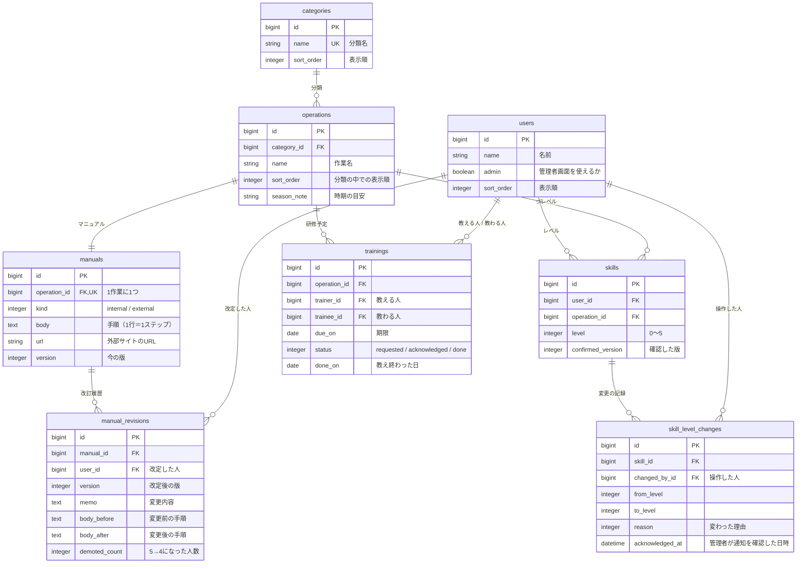

# データ設計（スキルレベル 0〜5 版）

画面と操作の仕様は [仕様書（docs/spec.md）](spec.md) に従います。このファイルは、その仕様を実現するためのテーブルと、レベルが変わるルールをまとめたものです。

## 1. 基本の考え方

- **スキルは「作業」に、版と改訂は「マニュアル」に付ける**。作業1つにマニュアル1つ（1対1）
- **管理者は役職ではなく、users の `admin` フラグで表す**。管理者画面を使えるのは `admin` が true の人
- **スキルを持つ人は `User.skill_holders` の1か所で決める**。いまは管理者以外（スタッフ5人）。スキルマップ・できる人の人数・教わる人の候補は、すべてこのスコープを使う
- **レベルは `skills.level` に今の値を持ち、変わるたびに `skill_level_changes` に記録する**。「申告を取り消す」で前のレベルに戻すため、また「誰が・いつ上げたか」を後から確かめるため
- **研修予定は、教わる人1人につき1件**。研修済み（誰から・いつ）は、完了した研修予定から求める
- **マニュアルを読んだかどうかは「どの版まで確認したか」で持つ**。改定で版が上がると、自動的に「再確認」「未読」の状態になる
- **手順はマニュアルの本文に1行＝1ステップで持つ**。ステップ専用のテーブルは作らない
- **画面の言葉とテーブル名**：画面の「作業」は `operations`（GitHub の Issue と紛れないため `tasks` にしない）、「研修予定」は `trainings`

```
users ──< skills >── operations >── categories
  │          └──< skill_level_changes
  │        operations ──1:1── manuals ──< manual_revisions
  └──< trainings（教える人／教わる人） >── operations
```

## 2. ER図



## 3. テーブル定義

共通：すべてのテーブルに `created_at` / `updated_at` を持つ。改定日などは、特に書かない限り `created_at` を使う。

### users（人）

| カラム | 型 | NULL | 説明 |
|---|---|---|---|
| name | string | NO | 例：山本 直子 |
| admin | boolean | NO | 管理者画面を使えるか。既定値 false |
| sort_order | integer | NO | 画面での並び順 |

- スコープ `User.skill_holders`：スキルを持つ人。いまは `where(admin: false)`
- 管理者には skills の行を作らない（いまの仕様。将来、管理者にもスキルを持たせるときは、このスコープを変えて行を作る）

### categories（分類）

| カラム | 型 | NULL | 説明 |
|---|---|---|---|
| name | string | NO | 例：入退社。ユニーク |
| sort_order | integer | NO | 表示順 |

### operations（作業）

| カラム | 型 | NULL | 説明 |
|---|---|---|---|
| category_id | references | NO | |
| name | string | NO | 例：年末調整 |
| sort_order | integer | NO | 分類の中での表示順 |
| season_note | string | YES | 時期の目安。例：毎年11月中に準備。研修画面の期限の横に目安として表示する（期限の初期値は入れない） |

- インデックス：`[category_id, name]` にユニーク制約

### manuals（マニュアル）

| カラム | 型 | NULL | 説明 |
|---|---|---|---|
| operation_id | references | NO | ユニーク（1作業に1つ） |
| kind | integer (enum) | NO | `internal: 0`（アプリ内に手順を持つ）, `external: 1`（外部サイトの手順を見る）。画面の表示は「アプリ内」「外部サイト」 |
| body | text | YES | アプリ内の手順。1行＝1ステップ。`internal` のとき必須 |
| url | string | YES | 外部サイトの URL。`external` のとき必須 |
| version | integer | NO | 今の版。既定値 1。画面では「第◯版」と表示する |

- enum の値を `url` にしないのは、同じ名前のカラム `url` と `url?` などのメソッドがぶつかるため
- 将来、アプリ内の手順に参考リンクも付けたくなったら、`internal` のまま `url` も入れられるようにする（バリデーションは「internal なら body 必須」だけにする）
- ステップの一覧は `Manual#steps`（本文を行で分け、空行を除いたもの）で求める
- 最終改定日は、`manual_revisions` のうち `version` が最大の行の `created_at`。改定がなければ「改定なし」

### manual_revisions（改訂履歴）

改定（版を上げる操作）1回につき1行。初版（第1版）の行は作らない。

| カラム | 型 | NULL | 説明 |
|---|---|---|---|
| manual_id | references | NO | |
| user_id | references | NO | 改定した人（管理者） |
| version | integer | NO | 改定後の版（2, 3, …） |
| memo | text | YES | 変更内容。空なら「（メモなし）」と表示 |
| body_before | text | YES | 変更前の手順（アプリ内のみ。画面には出さず、記録として残す） |
| body_after | text | YES | 変更後の手順（同上） |
| demoted_count | integer | NO | この改定でレベル5→4になった人数。既定値 0 |

- インデックス：`[manual_id, version]` にユニーク制約

### skills（スキル：スキルを持つ人 × 作業）

| カラム | 型 | NULL | 説明 |
|---|---|---|---|
| user_id | references | NO | `User.skill_holders` に入る人のみ |
| operation_id | references | NO | |
| level | integer | NO | 0〜5。既定値 0 |
| confirmed_version | integer | YES | 「マニュアルを確認した」を押したときの版。NULL＝一度も確認していない |

- インデックス：`[user_id, operation_id]` にユニーク制約
- バリデーション：`level` は 0〜5、ユーザーがスキルを持つ人であること
- スキルを持つ人 × 作業のすべての組み合わせに行を作っておく（シードで作成）
- 判定（その場で計算する）
  - **再確認／未読**（`unread?`）：`confirmed_version` が NULL ではなく、マニュアルの `version` より小さい
  - **確認ボタンを押せる**：`confirmed_version` が NULL か、マニュアルの `version` より小さい

### skill_level_changes（レベル変更の記録）

| カラム | 型 | NULL | 説明 |
|---|---|---|---|
| skill_id | references | NO | |
| changed_by_id | references (users) | NO | 操作した人。改定による自動の変更は改定した管理者 |
| from_level | integer | NO | 変更前 |
| to_level | integer | NO | 変更後 |
| reason | integer (enum) | NO | 下の表 |
| acknowledged_at | datetime | YES | 管理者が通知の帯で「確認しました」を押した日時。通知の対象（取り消しでレベル5から下がった記録）だけで使う。NULL＝未確認 |

| reason | 意味 | 変更 |
|---|---|---|
| `confirmed: 0` | マニュアルを確認した | 0 → 1 |
| `trained: 1` | 教え終わった | 0・1 → 2 |
| `self_declared: 2` | 自己申告 | 1・2 → 3、1〜3 → 4 |
| `declaration_undone: 3` | 申告を取り消した | 申告前のレベルへ |
| `approved: 4` | 管理者がレベル5を承認 | 4 → 5 |
| `approval_revoked: 5` | 管理者が承認を取り消した | 5 → 4 |
| `revision_demoted: 6` | 改定で自動的に戻った | 5 → 4 |

- **レベルが変わらない操作では記録を作らない**（レベル2以上での「教え終わった」、レベル1以上での「マニュアルを確認した」など）
- **申告を取り消せる条件**：その skill の記録のうち、管理者による変更（`approved`・`approval_revoked`・`revision_demoted`）を除いた直近の記録が、本人による `self_declared` であること。取り消しの直後は直近の記録が `declaration_undone` になるので、続けて取り消すことはできない（直近の1回だけ）
  - 管理者による変更を除くのは、レベル5に承認された人（本人の画面では4）も、自分で4を申告した人と同じように取り消せるようにするため。取り消せるかどうかでレベル5だと分からないようにする
- **取り消し後のレベル**：その `self_declared` の `from_level`。ただし、その作業で教わる人として `done` の研修予定があり、`from_level` が2未満のときは2にする（研修済みより下げない）。`declaration_undone` を、今のレベル（5のこともある）から戻したレベルへの変更として記録する
- **管理者への通知**：取り消しでレベル5から下がったとき（`declaration_undone` で `from_level` が5の記録）は、管理者画面の通知の帯に出す。「確認しました」で、未確認の記録すべての `acknowledged_at` に今の日時を入れる

### trainings（研修予定：教わる人1人につき1件）

| カラム | 型 | NULL | 説明 |
|---|---|---|---|
| operation_id | references | NO | |
| trainer_id | references (users) | NO | 教える人。作成時に、その作業のレベルが4以上のスキルを持つ人、または管理者（管理者はどの作業でも選べる） |
| trainee_id | references (users) | NO | 教わる人。作成時にその作業のレベルが0・1のスキルを持つ人 |
| due_on | date | YES | 期限。初期値は入れない（空のまま頼むこともできる） |
| status | integer (enum) | NO | `requested: 0`（教える人が未確認）, `acknowledged: 1`（確認済み）, `done: 2`（完了）。既定値 0 |
| done_on | date | YES | 教え終わった日 |

- バリデーション：教える人と教わる人は別の人。同じ作業・同じ教わる人で、完了していない予定は1件まで
- 教わる人・教える人のレベルの条件は、作成時だけ確かめる（`on: :create`）。作成後に教わる人が自己申告でレベル3以上になっても、教える人が申告を取り消してレベル4未満になっても、予定はそのまま続け、確認・完了・期限の変更ができる
- 教える人が管理者のときは、作成時から `acknowledged` にする（管理者自身が頼んだので、通知の帯で確認する必要がない）。画面では「管理者が担当」と表示する
- 完了前は削除できる（「取り消す」）。完了後は削除できない
- **画面での表示**：予定は教わる人ごとに1枚のカードで表示する。「教え終わった」「取り消す」も1件ずつ行う
- **研修画面の保存**：研修画面での変更（予定の追加・取り消し・期限の変更）は、画面の中で下書きとして持ち、「変更を保存」を押したときにまとめて DB に反映する（1つのトランザクションで、予定の作成・削除と `due_on` の更新を行う）。下書きの間は、追加した予定のチップをもう一度押すと取り消せる
  - 「変更を保存」を押せるのは、研修予定の追加、保存済みの研修予定の取り消し、研修予定がある作業（下書きで追加したものも含む）の期限の変更、のどれかがあるとき。保存せずに画面を離れるときの確認（「変更は保存されませんがよろしいですか？」）も、同じ条件のときだけ出す
  - **期限は研修予定にだけ持つ**：研修予定がない作業の期限は保存しない（作業ごとの期限のカラムは作らない）。研修画面のカードの日付は、その作業の未完了の予定の `due_on` を表示し、予定がなければ空にする
- **期限は作業ごと**：研修画面で期限を変えると、その作業の未完了の予定すべての `due_on` が同じ値になる
- **研修済み（誰から・いつ）**：その作業・その教わる人の、`done` の予定のうち最新のもの。教える人の名前と `done_on` を表示する

## 4. レベルが変わるルール

| 操作 | 押す人 | 押せる条件 | 起きること |
|---|---|---|---|
| マニュアルを確認した | スタッフ本人 | 確認ボタンを押せる状態 | `confirmed_version` を今の版にする。レベル0なら1にする |
| 研修を頼む・取り消す・期限を変える（「変更を保存」） | 管理者 | 頼むのは、教わる人がその作業で未完了の予定を持っていないとき。取り消すのは未完了の予定だけ | 追加した予定は教わる人ごとに trainings を1件ずつ作る（教える人が管理者なら `acknowledged` で作る）。取り消した予定は削除する。期限を変えた作業は、未完了の予定の `due_on` をすべて更新する |
| 確認しました（通知の帯） | 教える人 | 自分あての `requested` がある | 自分あての `requested` をすべて `acknowledged` にする |
| 教え終わった | 教える人（管理者が担当の予定は管理者が研修画面から） | 予定が未完了 | その予定を `done` にし、`done_on` を入れる。教わる人がレベル0・1なら2にする（2以上ならそのまま） |
| 先輩のもとでできる | スタッフ本人 | レベル1・2 | レベル3にする |
| 最後まで1人でできる | スタッフ本人 | レベル1〜3 | レベル4にする |
| 申告を取り消す | スタッフ本人 | 管理者による変更を除いた直近の記録が、本人の自己申告 | その申告の `from_level` に戻す（研修済みなら2より下げない）。レベル5から下がったときは管理者の通知の帯に出す |
| レベル5として承認 | 管理者 | レベル4 | レベル5にする |
| 承認を取り消す | 管理者 | レベル5 | レベル4にする |
| 確認しました（管理者の通知の帯） | 管理者 | 未確認の通知がある | 通知の対象の記録すべての `acknowledged_at` に今の日時を入れる（レベルは変えない） |
| 改定して保存／改定あり | 管理者 | ― | マニュアルの版を1上げ、改訂履歴に1行追加。その作業のレベル5の人を全員4にし、人数を `demoted_count` に入れる。ほかのレベルと `confirmed_version` は変えない |

- レベルが変わる操作はすべて、`skills.level` の更新と `skill_level_changes` の追加を1つのトランザクションで行う（`app/services/` に置く）

## 5. その場で計算するもの（テーブルを作らない）

| 画面の要素 | 求め方 |
|---|---|
| できる人◯人 | その作業でレベル4以上のスキルを持つ人の人数。1人以下で警告 |
| 教える人の候補 | その作業でレベル4以上の人（5の人が先）と、管理者（いつも最後に出す） |
| 教わる人の候補 | その作業でレベル0・1の人のうち、その作業で未完了の予定がない人 |
| 研修画面の状態（未指示／一部 指示済み／指示済み） | その作業でレベル0・1の人のうち、未完了の予定がある人がいなければ「未指示」、一部なら「一部 指示済み」、全員なら「指示済み」 |
| 改訂のお知らせの件数 | 自分の skill のうち `unread?` のもの |
| 通知の帯（スタッフ） | 自分が教える人で、`requested` の予定 |
| 通知の帯（管理者） | `skill_level_changes` のうち、`declaration_undone` で `from_level` が5、`acknowledged_at` が NULL のもの |
| 研修画面のカードの日付 | その作業の未完了の予定の `due_on`。予定がなければ空 |
| 期限の色 | `due_on` まで14日以内ならオレンジ |

## 6. レベル5をスタッフに見せない

- スタッフ画面では、レベルは `min(level, 4)` で表示する。HTML の属性・JSON・Turbo Stream にも5を出さない
- 表示用の値は `Skill#level_for(viewer)` のように1か所で求め、ビューで `level` を直接使わない
- 改訂のお知らせ（スタッフ）には「5→4になった人数」を出さない
- Request spec で「スタッフ画面の HTML に、レベル5を表す値が含まれない」ことを確かめる

## 7. テーブルを作らないもの

| 要素 | 方針 |
|---|---|
| ログイン | 作らない。ヘッダーで選んだユーザーを `session[:user_id]` に保存する。何も選んでいないときは管理者 |
| 作業・分類・ユーザーの追加画面 | 作らない。シードで用意する |
| 通知・件数 | 通知用のテーブルは作らず、その場で計算する。管理者の通知の確認状態だけは `skill_level_changes.acknowledged_at` に持つ |
