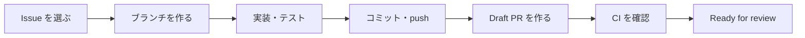

# 開発の進め方（最初の Pull Request まで）

[開発環境の構築](setup.md) が終わったら、この手順で 1 つの Issue を実装して Pull Request（PR）を出すところまで進めます。
チームのルール（役割・スケジュール・カンバンの運用）はキックオフ資料（`docs/kickoff.md`）にあります。

## 全体の流れ



## 1. 最初に読むもの

| 順番 | ドキュメント | 読む目的 |
|---|---|---|
| 1 | キックオフ資料（`docs/kickoff.md`） | 目的・体制・開発ルール（ブランチ・テスト・コミュニケーション） |
| 2 | 要件定義（`docs/requirements.md`） | 誰のための何のアプリか、各機能の受入条件 |
| 3 | 画面設計（`docs/screens.md`） | 画面一覧と画面遷移、各画面の要素 |
| 4 | [仕様書](../spec.md) | スキルレベルのルール、画面の操作、主な流れ |
| 5 | [データ設計](../data-model.md) | テーブルとカラム、レベルが変わるルール |

画面の見た目は `mock/mock.html` をブラウザで開いて確かめます。
AI（Codex・Claude Code）で開発するときは、`AGENTS.md`（Claude Code は `CLAUDE.md` 経由）が自動で読み込まれます。

## 2. Issue を選ぶ

1. [カンバン（GitHub Projects）](https://github.com/users/amiami/projects/3) を開く（リポジトリの Issues からも探せる）
2. **Ready** 列の Issue から担当を決め、Issue の右側 **Assignees** に自分を設定する
3. Issue 本文の **受入条件（チェックリスト）** を読み、何ができれば完了かを確認する
   - 分からないことは、着手前に Issue のコメントかチャンネルで質問する
4. 着手したら、カンバンのカードを **In Progress** に移し、チャンネルで「これから #番号 をやります」と一言伝える（同時に持つのは 1 人 2 枚まで）

## 3. ブランチを作る

ブランチは「作業用のコピー」です。`main` で直接作業はしません。

```bash
git switch main
git pull
```

Issue がエピック（大きな要件）の子 Issue かどうかで、ブランチを作る元が変わります。Issue 本文の「親エピック」に番号が書かれていれば子 Issue です。

```bash
# エピックの子 Issue の場合：epic ブランチから作る
git fetch origin
git switch -c feature/<Issue番号>-<短い英語の説明> origin/epic/<エピック番号>-<説明>

# エピックではない小さな作業（資料の修正など）の場合：main から作る
git switch -c feature/<Issue番号>-<短い英語の説明>
```

- 例：`feature/40-operation-models`（親は `epic/28-data-foundation`）。バグ修正なら `fix/<番号>-<説明>`
- epic ブランチは、そのエピックに最初に着手する人が `main` から作って push します（すでにあれば作らない）

```bash
git switch main && git pull
git switch -c epic/<エピック番号>-<短い英語の説明>
git push -u origin HEAD
```

## 4. 実装する

- アプリは `docker compose up -d` で起動したまま、エディタでファイルを編集し、ブラウザを再読み込みして確認する
- **受入条件 → テスト（失敗する）→ 実装（通る）→ リファクタ** の順で進める。書き方は既存の `spec/` を参考にする
- 仕様と違う作りになったときは、同じ PR で `docs/` も直す
- マイグレーションを追加したら、`docker compose run --rm web bin/rails db:prepare` で手元に適用して確かめる

こまめにテストと書き方チェックを実行します。

```bash
docker compose run --rm web bundle exec rspec
docker compose run --rm web bin/rubocop -a
```

## 5. コミットして push する

```bash
git status                  # 変更したファイルを確認
git add <ファイル名>         # コミットに含めるファイルを選ぶ
git commit -m "feat: 作業とマニュアルのモデルを追加"
git push -u origin HEAD     # GitHub に送る（2 回目以降は git push だけでよい）
```

コミットメッセージは `<種別>: <要約>` の形で書きます。要約は日本語でかまいません。

| 種別 | 使うとき |
|---|---|
| `feat` | 機能を追加・変更した |
| `fix` | 不具合を直した |
| `refactor` | 動きを変えずにコードを整理した |
| `test` | テストだけを追加・修正した |
| `docs` | 資料だけを変えた |
| `chore` | 設定・依存ライブラリなど、上のどれにも当たらない |

## 6. Draft PR を作る

最初は必ず Draft（下書き）で作ります。

1. push 後に GitHub に表示される **Compare & pull request** を押す
2. 向き先（base）を選ぶ。エピックの子 Issue なら epic ブランチ、それ以外は `main`
3. **Create draft pull request** を押す

本文は PR テンプレート（`.github/pull_request_template.md`）が自動で入るので、説明コメントに従って書き換えます。`Closes #<Issue番号>` は必ず書きます。

## 7. CI を確認して Ready for review にする

PR を作ると、GitHub Actions（CI）が自動でテスト・書き方チェック・セキュリティ診断を実行します。

1. PR の下部にあるチェックがすべて緑（✓）になるのを待つ
2. 赤（×）になったら **Details** を開いてエラーを確認し、手元で直して push し直す
3. PR テンプレートのセルフチェックを埋める
4. **Ready for review** を押し、カンバンのカードを **Review** に移す

マージの条件と方法は、向き先によって違います。

| PR | マージの条件 | マージの方法 |
|---|---|---|
| 子 Issue → epic ブランチ | CI がすべて緑（レビューは不要） | Squash and merge |
| epic ブランチ → `main`（まとめの PR） | CI がすべて緑 ＋ レビュー承認 1 名（設計に関わる変更はテックリードの承認が必須） | Create a merge commit |
| 小さな作業 → `main` | CI がすべて緑 ＋ レビュー承認 1 名 | Squash and merge |

- Issue が自動で閉じるのは `main` に入ったときだけです。子 Issue がすべて終わったら epic ブランチ → `main` のまとめの PR を作り、本文にエピックと子 Issue の `Closes` を全部並べます

## 8. マージされたら

```bash
git switch main
git pull
git branch -d feature/<Issue番号>-<説明>   # 手元の作業ブランチを消す
```

カンバンのカードが **Done** に移っていることを確認して、次の Issue に進みます。

## AI を使うときの約束

- **AI が書いたコードも、自分で説明できる状態にしてから PR を出す**。レビューで「なぜこう書いたか」に答えられるようにする
- AI の出力が `docs/` や `AGENTS.md` のルールと食い違ったら、ルールのほうを優先する。ルール自体を変えたいときはテックリードに相談する
- 開発中に分かったこと（つまずいて解決したこと、レビューで指摘された型）は `.agents/knowledge/` に短く追記する

## 困ったとき

- 30 分調べても進まなければ、Mattermost の「Aチーム NCT × RUNTEQハッカソン」チャンネルで質問する（質問のテンプレートはキックオフ資料の (9)）
- 環境のトラブルは [開発環境の構築](setup.md#6-うまく動かないとき)
- Git の操作で迷ったら、何かを消したり上書きしたりする前に相談する（`git reset --hard` や `git push --force` は使わない）
