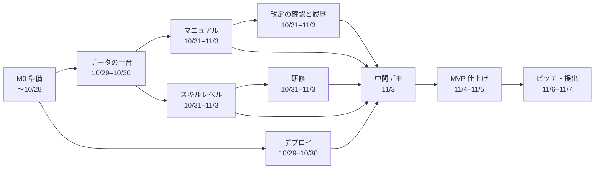
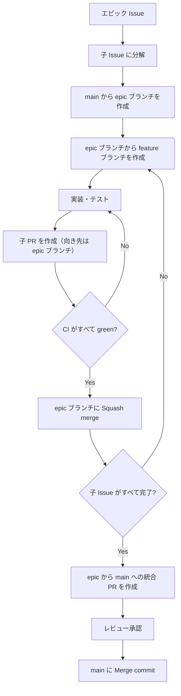

# キックオフ資料 — マニュあっぷ（スキルレベル×マニュアル管理アプリ）

## (1) プロダクトの目的とゴール

### 解決したい課題

中小企業の人事部では、誰に何を教えたか・誰がどこまでできるか・マニュアルの改定を誰が読んだかが記録されていない。
そのため、評価・人材配置・引き継ぎ・新人教育のたびに本人に確認する手間がかかり、特定の人しかできない作業（属人化）にも気づけない。

### プロダクトのゴール

マニュアルを1つのアプリに集め、作業ごとに「誰がどこまでできるか」をスキルレベル（0〜4）で見えるようにし、部長の判断は管理者の見立て（▲・▼・▽・◇）で添える。できる人が少ない作業には、期限つきで研修を割り振れるようにする。

### 成功の条件（案・PdM が確定）

| 観点 | 条件 |
|---|---|
| 体験 | 部長がスキルマップから「できる人が少ない作業」を見つけ、研修を頼むまでを迷わずに終えられる |
| 正しさ | レベルの上がり方、管理者の見立てと研修の候補、再確認／未読が [仕様書](spec.md) どおりに動く |
| デモ | 本番で次のデモの流れがエラーなく通る。研修依頼から終了報告まで：できる人が少ない作業を見つける → 研修を頼む → 教え終わった → 自己申告（管理者による承認なし）。▲の効果の実演：レベル3の人に▲を付ける → 研修依頼を出す |

### MVP の範囲

| 区分 | 内容 |
|---|---|
| MVP | 作業ツリーとマニュアル、「確認した」、改定と改訂履歴、再確認／未読、スキルマップ、自己申告（レベル3・4）、管理者の見立て（▲・▼・◇を付ける）、研修（頼む・変更を保存・教え終わった・取り消し）、わたしのスキル、できる人チェック、管理者／スタッフの切り替え |
| 拡張（時間があれば） | 各画面の検索、教える予定の通知の帯、自己申告の取り消し、改訂のお知らせ（スタッフ） |
| 対象外 | ログイン・パスワード、メール通知、作業・分類・ユーザーの追加画面（サンプルデータで用意）、対応回数の記録 |

## (2) チームの役割と責任範囲

役割は「視点と責任の分担」です。作業量の分担ではないので、全員が実装もします。

| 役割 | 責任範囲 | 主に見るもの | 判断すること |
|---|---|---|---|
| プロダクトマネージャー（PdM） | 要件定義・優先順位・受入判断 | `docs/requirements.md`、カンバンの Backlog / Ready、デモ | 何を作るか・作らないか、機能の受入 OK/NG |
| プロジェクトマネージャー（PjM） | スケジュール・進捗・リスク管理 | カンバン全体、マイルストーン | スコープ調整の提案、停滞時のエスカレーション |
| テックリード（TL） | 設計・技術選定・コード品質 | PR、[データ設計](data-model.md)、[技術選定](tech-stack.md) | 設計方針、PR の最終承認、技術的な優先度 |
| ピッチ担当 | ピッチ資料・デモ台本 | `docs/requirements.md`（課題）、デモ | 何をどう伝えるか |
| エンジニアメンバー | 実装・テスト・PR 作成・レビュー | 担当 Issue、PR | 実装方法（設計方針の範囲内） |

### 相談先

| 困りごと | 相談先 |
|---|---|
| 仕様が曖昧／要件の解釈に迷う | PdM |
| 期限に間に合わない／作業が重なっている | PjM |
| 設計・実装方針・技術的に詰まった | TL |
| ピッチ・デモで何を見せるか迷う | ピッチ担当 |
| 環境構築・ツールの使い方 | メンバー同士 → 解決しなければ TL |

## (3) スケジュールとマイルストーン

期間：〜 2026-11-08（日）の最終ピッチ。開発は 11/5 まで、11/6・11/7 はピッチ対応。提出は 11/7（土）23:59。
MVP をエピック単位に分け、依存関係から逆算してマイルストーンを置いている。

| 日程 | マイルストーン（期限） | エピック・タスク | 完了の目安 |
|---|---|---|---|
| 〜10/28 | M0 準備（10/28） | 雛形／データ設計／画面設計／マイルストーンとエピック／全員の開発環境 | 全員の手元でアプリが起動し、資料が `docs/` にそろう |
| 10/29–10/30 | M1 土台・デプロイ基盤（10/30） | データの土台／本番環境へのデプロイ ※並行 | 管理者4タブ・スタッフ3タブに移動でき、サンプルデータが入る。`main` へのマージで本番に反映される |
| 10/31–11/3 | M2 主要機能（11/3） | マニュアル／スキルレベル／研修／改定の確認と履歴 | 本番で研修の流れと改定の流れが一通り動く |
| 11/3 | 中間デモ | — | PdM が受入判断し、残課題と拡張の優先度を決める |
| 11/4–11/5 | M3 MVP 完成（11/5） | MVP 仕上げ | 本番でデモの流れがエラーなく通る。11/5 中に `main` へのマージを止める |
| 11/6–11/7 | M4 ピッチ・提出（11/7） | ピッチ・提出 | 11/7 23:59 までにモックとピッチ資料を事務局にメールで提出 |
| 11/8 | 最終ピッチ | — | 13:00〜17:00。発表 5 分＋質疑 5 分。評価は「課題解決の説得性」と「ピッチ内容」 |



- クリティカルパスは「データの土台 → スキルレベル → 研修 → MVP 仕上げ」。ここが遅れると中間デモに影響するため、遅れが見えた時点で PjM が並行エピックから人を回すかスコープを調整する
- 各エピックは着手時に子 Issue へ分解する（子 Issue は 10/30 までに作る。(6) 開発フロー）
- マイルストーンと期限は GitHub の [Milestones](https://github.com/amiami/NCT_RUNTEQ_hackathon_app/milestones) で管理する。エピックと Issue の番号はそちらで確認する
- 拡張は MVP の後に扱う

### 定例

定例会は 19:00〜21:00（(9) 参照）。中間デモは 11/3。

## (4) 技術スタックと開発環境

| 区分 | 採用技術 |
|---|---|
| 言語 / FW | Ruby 3.4 / Rails 8.1 |
| フロント | Hotwire（Turbo・Stimulus）、Tailwind CSS v4（UI 部品ライブラリは使わない）、importmap |
| DB | PostgreSQL 17 |
| テスト | RSpec、FactoryBot、Capybara ＋ Cuprite、WebMock、SimpleCov |
| 品質 | RuboCop（rubocop-rails-omakase ＋ rubocop-rspec）、Brakeman、bundler-audit、importmap audit |
| 環境 | Docker Compose（web / db / css） |
| 本番 | Render（アプリ）＋ Neon（PostgreSQL）。`main` へのマージで自動デプロイ |
| AI 開発ツール | Codex・Claude Code。共通ルールは [AGENTS.md](../AGENTS.md)（Claude Code は `CLAUDE.md` 経由で読む） |

- パソコンに入れるのは Docker Desktop と Git だけ。セットアップ手順は [開発環境の構築](dev/setup.md) を参照
- ログイン機能は作らない。ヘッダーで選んだユーザーをセッションに保存し、管理者とスタッフ5人を切り替えてデモする
- 選んだ理由と検討した候補は [技術選定](tech-stack.md) を参照

## (5) 命名規則・Lint・コードスタイル

- **Rails 標準の命名**に従う（モデルは単数形 `Operation`、テーブル・コントローラは複数形 `operations` / `OperationsController`、ファイルはスネークケース）
- 画面の言葉とコードの名前：「作業」は `operations`（GitHub の Issue と紛れないため `tasks` にしない）、「研修予定」は `trainings`。表示順のカラムは `sort_order`（「ポジション（役職）」と紛れないため `position` にしない）
- 1つのモデルで済む処理はモデルに書き、複数のモデルにまたがる処理は `app/services/` に置く。**レベルを変える処理はすべてサービスを通し、変更の記録（`skill_level_changes`）と同じトランザクションで行う**
- コントローラは REST の 7 アクションに収める。それ以外の操作はリソースを切り出す（例：管理者の見立ての変更 → `Skills::AssessmentsController#update`）
- 画面の動きはまず Turbo で作り、足りないところだけ Stimulus を使う
- 色・文字は `app/assets/tailwind/application.css` の `@theme` のトークン名で指定し、16 進数をビューに書かない。ボタン・バッジ・カードなどの見た目は同じファイルの `@layer components` にまとめ、ビューに `style` を書かない
- 画面の文言は日本語、日時は日本時間。アプリ名は `t("app_name")` で使う
- Lint は RuboCop（`.rubocop.yml`）。**CI で違反があればマージしない**。手元では `docker compose run --rm web bin/rubocop -a` で自動修正できる
- RSpec の `describe` / `it` は日本語で書いてよい
- コミットメッセージ：`<種別>: <要約>`（種別：`feat` / `fix` / `refactor` / `test` / `docs` / `chore`）。要約は日本語でよい
- 詳しいルールは [AGENTS.md](../AGENTS.md)（AI もこのファイルを読む）

## (6) 開発フロー（GitHub Flow ＋ エピックブランチ）

大きな要件はエピックとして扱い、子 Issue に分解して進める。



| ブランチ | 作成元 | 命名 |
|---|---|---|
| `main` | — | 常設。常にデプロイ可能な状態を保つ |
| epic ブランチ | `main` | `epic/<エピックの Issue 番号>-<短い説明>` |
| feature ブランチ | epic ブランチ | `feature/<子 Issue 番号>-<短い説明>`（バグ修正は `fix/…`） |

| マージ | 条件 | 方法 |
|---|---|---|
| 子 PR → epic ブランチ | CI がすべて green（レビューは不要） | Squash merge |
| epic ブランチ → `main` | CI がすべて green ＋ レビュー承認 1 名（設計に関わる変更は TL の承認必須） | Merge commit |

- epic ブランチは、そのエピックに最初に着手する人が `main` から作る（すでにあれば作らない）
- PR は **Draft で作成** し、CI が通ってセルフチェックが済んだら Ready for review にする
- 子 PR の本文に `Closes #<子 Issue 番号>` を書く。向き先が `main` ではないため、この時点では Issue は閉じない。epic → `main` の統合 PR の本文に、エピックと全子 Issue の `Closes` を並べ、`main` へのマージ時にまとめて閉じる
- エピックにする必要がない小さな作業（資料の修正など）は、`main` から feature ブランチを切り、`main` 向けの PR を作る（CI green ＋ レビュー承認 1 名で Squash merge）
- 仕様が変わったら、同じ PR で `docs/` も直す
- 手順は [開発の進め方](dev/first-contribution.md) を参照

### 依存ライブラリの更新（Dependabot）

Dependabot が、gem や GitHub Actions の更新の PR を `main` 向けに自動で作る。`main` にマージすると本番にデプロイされるので、マージ後は本番が動くかを確認する。

| 種類 | 届く日 | 確認する人 | マージ |
|---|---|---|---|
| バージョン更新 | 毎日（一度に開く PR は5本まで） | その日の当番（毎日交代） | CI green ＋ 当番の承認で Squash merge。**11/6 以降はマージせず、PR は開いたまま残す** |
| セキュリティ更新 | 脆弱性が見つかったとき（いつでも） | TL（届いた日のうちに） | CI green ＋ TL の承認で Squash merge。**11/7 まではマージする。11/8 に届いた分は発表が終わってからマージする** |

- 承認1名のルールは、当番（セキュリティ更新は TL）の承認で満たす
- PR は閉じない。閉じると Dependabot が同じ更新の PR を作り直さなくなるため
- 設定は `.github/dependabot.yml`。理由は [技術選定](tech-stack.md) を参照

## (7) テストコード方針

| 種類 | 置き場所 | 何を書くか | 優先度 |
|---|---|---|---|
| Model spec | `spec/models` | バリデーション、レベルの範囲（0〜4）、スキルを持つ人以外の Skill は作れない、管理者の見立てを付けられるレベル、研修予定のルール（教える人と教わる人は別、未完了は1件まで、教える人・教わる人の条件）、できる人の判定 | ◎ 最初に書く |
| Service spec | `spec/services` | レベルを変えるサービス（`skill_level_changes` に記録される、申告の取り消しは1回だけ）、改定（版が上がり、レベルと見立ては変わらない）、研修画面の「変更を保存」、▼の人の「教え終わった」で▽になる | ◎ |
| Request spec | `spec/requests` | 画面の表示・保存、管理者画面にスタッフが入れないこと、**スタッフ画面の HTML に管理者の見立てを表す値が含まれないこと** | ○ |
| System spec | `spec/system` | 主要な流れのみ（研修を頼む → 教え終わった → 教わった人のレベルが2になる） | △ 最小限 |

- Issue の受入条件をテストケースに落としてから実装する（Red → Green → Refactor）
- テストデータは FactoryBot で作る。日付に関わるテストは `travel_to` で日時を固定する
- 外部通信は WebMock で遮断している
- CI（GitHub Actions）で RuboCop・Brakeman・bundler-audit・importmap audit・RSpec を実行する。すべて green でないとマージしない
- テストを通すためにテストを消したり `skip` にしたりしない
- カバレッジは SimpleCov で測るが、参考値として扱う。数値を上げるためだけのテストは書かず、カバレッジ不足でマージを止めることもしない

## (8) タスク管理と運用ルール

### カンバン（GitHub Projects）

[カンバンを開く](https://github.com/users/amiami/projects/3)（マイルストーンは [Milestones](https://github.com/amiami/NCT_RUNTEQ_hackathon_app/milestones)）

| 列 | 意味 | 入れる人 |
|---|---|---|
| Backlog | アイデア・未整理 | 誰でも |
| Ready | 受入条件が書かれ、着手できる | PdM（優先度順に並べる） |
| In Progress | 作業中 | 担当者 |
| Review | PR レビュー待ち | 担当者 |
| Done | マージ済み | 自動 |

- WIP 制限：In Progress は 1 人 2 枚まで
- Issue には受入条件（チェックリスト）を必ず書く（`.github/ISSUE_TEMPLATE` を使う）
- 担当・ラベル・マイルストーンは本文ではなく右側の欄で設定する。ラベルは `epic`（エピック）、`enhancement`（機能開発の子 Issue）、`bug`（不具合）、`documentation`（資料）
- 見積もりは半日〜1日以内に収まる粒度に分割する

### 停滞したときのルール

| 状況 | アクション |
|---|---|
| 30 分調べても解決しない | チャンネルで質問する（下記テンプレート） |
| カードが 2 日動かない | チャンネルで状況を共有する。PjM が分割・担当変更を提案 |
| PR がレビュー待ちのまま半日経過 | レビュアーにメンション。当日中にレビューする |
| マイルストーンに間に合わない見込み | 判明した時点で PjM に連絡 → PdM とスコープ調整 |

## (9) コミュニケーションルール

### チャンネル

連絡・相談・質問・共有は、すべて Mattermost の「Aチーム NCT × RUNTEQハッカソン」チャンネルで行う。

### 質問のしかた

- 個別 DM ではなくチャンネルで質問する（他の人の学びになる）
- 返信はスレッドで行う
- 以下のテンプレートで書く

```
【やりたいこと】
【起きていること】（エラーメッセージはコードブロックで）
【試したこと】
【仮説】
【関連 Issue / PR】
```

### ミーティング

定例会は 19:00〜21:00。

### 決定事項の置き場所

決まったことは `docs/` にまとめ、`docs/` を正とする。Notion は下書きの置き場所として使う。
