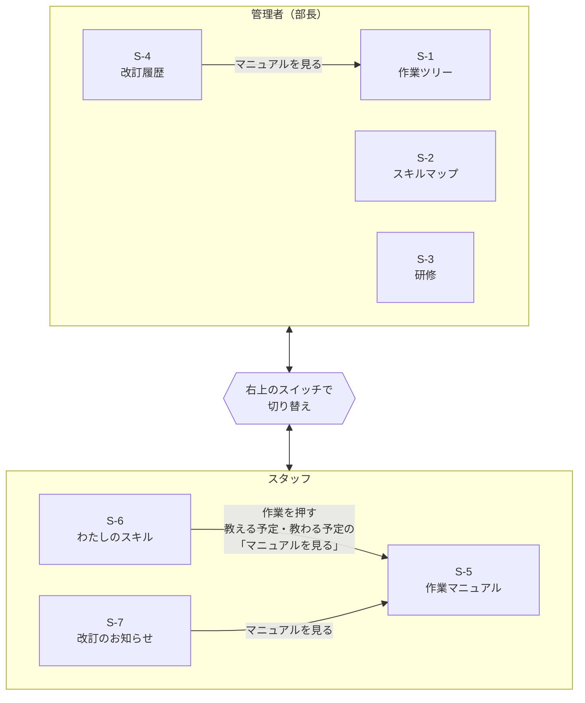

# 画面設計

画面の見た目は [モック](../mock/mock.html) を参考にします。動きと言葉は [仕様書](spec.md) を優先します。画面遷移図は Figma（マニュあっぷ 画面遷移図）にもあります。

## 画面一覧

| ID | 画面名 | 使う人 | URL（実装予定） | 検索 | 対応 UC |
|---|---|---|---|---|---|
| S-1 | 作業ツリー（マニュアル） | 管理者 | ルーティングで決める | 作業名・分類 | UC-1, 2, 9 |
| S-2 | スキルマップ | 管理者 | ルーティングで決める | 作業名・分類・スタッフ名 | UC-3, 5, 6, 9 |
| S-3 | 研修 | 管理者 | ルーティングで決める | 作業名・スタッフ名 | UC-7, 9 |
| S-4 | 改訂履歴 | 管理者 | ルーティングで決める | 作業名・変更内容・日付 | UC-3 |
| S-5 | 作業マニュアル | スタッフ | ルーティングで決める | 作業名・分類 | UC-1, 3, 4 |
| S-6 | わたしのスキル | スタッフ | ルーティングで決める | ― | UC-6, 8 |
| S-7 | 改訂のお知らせ | スタッフ | ルーティングで決める | 作業名・変更内容・日付 | UC-3 |

UC の番号は [要件定義](requirements.md) のユースケースです。

## 画面遷移図

同じ立場の画面どうしはタブで移動できる（図では省略）。スタッフ画面の通知の帯のリンクからは S-5 のその作業へ移る。S-2・S-3 で未保存の変更があるまま別のタブ・スタッフ画面へ移ろうとすると、確認ダイアログが出る。

## 共通レイアウト

- ヘッダー：右上に「管理者（部長）」と「スタッフ」の切り替えスイッチ。スタッフ側は操作する人を5人から選ぶ（ログイン機能は作らない）。選んだ人は画面を移っても変わらず、何も選んでいないときは部長になる。スタッフとして操作しているときに管理者の画面の URL を開くと、スタッフの画面に戻して理由を表示する
- タブ：管理者は S-1〜S-4、スタッフは S-5〜S-7。今いる画面のタブを強調する。S-2 には通知件数を出す（実際に何を数えるかは別途定義する）。S-6 には完了していない教える・教わる予定の件数、S-7 には未確認の件数を出す
- タブの件数（S-2・S-6・S-7）：実件数の集計を接続するまでは仮表示。未指定・`nil` は99、0を含む指定値はそのまま表示する。99は実際の通知件数ではない
- 凡例：画面上部にスキルレベルの凡例を常に表示する（管理者画面・スタッフ画面とも0〜4）。管理者画面には管理者の見立て（▲ 研修権限・▼ 要研修・▽ 研修済み・◇ 教えるのは後回し）の説明も出す
- 通知の帯（スタッフ）：教える予定が届くと画面上部に青い帯が出る。「確認しました」を押すと帯が消え、管理者の「指示済みの研修」に「教える人が確認済み」と表示される（拡張）
- 検索バー：一覧画面に置く（拡張）
- 押せないボタンは薄く表示する
- 管理者の見立てはスタッフ画面に出さない（HTML の中も含む）
- 対象は PC 幅のみ

### 共通レイアウトの接続

- 共通の立場名・タブ名・ページ見出し（ブラウザのタイトルを含む）は `config/locales/ja.yml` に定義し、ビューでは `t` で参照する。立場の切り替えの文言は `navigation.roles`・`operators`、タブ名は `navigation.admin` / `navigation.staff`、見出しは `page_titles.admin` / `page_titles.staff` に画面名を渡す。

- URL：管理者は `/admin/operations`・`/admin/skill_map`・`/admin/trainings`・`/admin/manual_revisions`。スタッフは `/staff/operations`・`/staff/skills`・`/staff/manual_revisions`。
- ルート `/` は、操作している人の立場に合った最初の画面に移る。部長（何も選んでいないときも含む）は管理者の作業ツリー（`/admin/operations`）、スタッフはスタッフの作業マニュアル（`/staff/operations`）。移るときに注意は出さない。各画面の本文は専用の `app/views/admin/…`・`app/views/staff/…` に置き、h1に立場（管理者／スタッフ）と画面名を表示する。
- `shared/header` にタイトル・操作する人の切り替えスイッチ・タブ・常時表示のレベル凡例と開閉式の「レベルの説明」・フラッシュ通知枠をまとめる。共通レイアウトから一度だけ呼び出す。
- フラッシュは `flash` / `flash.now` のnotice・alert等を表示する。通知がなければ余白を出さず、`flash-messages` の差し替え先だけを残す。研修依頼の通知の帯は別機能。
- 操作する人は `PATCH /operator` で切り替え、`session[:user_id]` に保存する。`current_user` は、選んだスタッフ（`User.skill_holders` の1人）。何も選んでいない、または選んだ人がいなくなったときは部長（管理者）になる。管理者の画面は `Admin::BaseController` で守り、スタッフとして操作しているときに開くとスタッフの画面に戻して理由を表示する。URLの名前空間は認可の代わりにならない。
- 件数バッジは、当面は仮表示で用意する。`shared/header` または `shared/tabs` へ `skill_map_count`（管理者のスキルマップ）・`training_count`（スタッフのわたしのスキル）・`unread_count`（スタッフの改訂のお知らせ）を渡す。未指定時などの表示は、上記「タブの件数」のルールに従う。管理者の作業ツリー・研修・改訂履歴とスタッフの作業マニュアルには件数を出さない。
- 共通レイアウトから `render "shared/header", **navigation_counts` で件数を渡す。`NavigationHelper#navigation_counts` は現在 `{}` を返す。`current_user` は実装済みで、このメソッドで対象ユーザーの件数を集計し、`{ skill_map_count: 4, training_count: 3, unread_count: 0 }` のようなハッシュを返す。各画面のビューからヘッダーを再描画する必要はない。仮表示99を実際の未完了・未確認件数としては扱わない。

## 各画面の要素

### S-1 作業ツリー（管理者）

| 要素 | 内容 |
|---|---|
| ツリー（左） | 分類 → 作業。できる人が1人以下なら「できる人○人」、それ以外で改定済みなら「改定 10/20」のバッジ |
| マニュアル（右） | アプリ内は番号付きの手順、外部サイトはリンクと「サイトを開く」 |
| 作業名の横 | 種類・版（第○版）・最終改定日・時期の目安。できる人が1人以下のときだけ「できる人○人」 |
| スタッフ状況（下） | この作業のスタッフの名前・レベル・マニュアル確認状況・研修済み |

| 操作 | 結果 |
|---|---|
| 「手順を書き直す（改定）」（アプリ内） | 1行＝1ステップで編集し、改定メモを書いて「改定して保存」 |
| 「改定あり」（外部サイト） | 変更内容のメモを書いて保存 |
| 改定を保存したとき | 版が上がり、S-4 に1件追加。レベルと管理者の見立ては変わらない |

### S-2 スキルマップ（管理者）

| 要素 | 内容 |
|---|---|
| 表 | 行＝作業（分類ごと）、列＝スタッフ。マスはレベルの数字（高いほど濃い青） |
| マスの印 | 「未読」（改定後のマニュアルを未確認）と、管理者の見立て（▲・▼・▽・◇）。見立てはマスの右上に出し、マウスを乗せると説明が出る。今のレベルで意味のある見立てだけ出す（レベル3は▲・▼・▽、レベル4は▼・◇。レベル4の▲・▽、レベル3の◇は値を残して出さない） |
| 警告 | できる人が1人以下の作業があれば上部に警告と「できる人が1人以下の作業だけ表示」。行・分類の見出しにも「できる人○人」 |
| マスの詳細 | マスを押すと上に出る。マニュアル確認状況、研修（済み〈○○さんから・日付〉／なし〈自分で習得〉／まだ）、管理者の見立て |

| 操作 | 結果 |
|---|---|
| 詳細で見立てを選ぶ | なし／▲・▼（レベル3のときだけ）／◇（レベル4のときだけ）。選んだだけでは未決定で、右下に「変更を保存」が出る。表示しない見立ての人は「なし」と出し、別の見立てを選んで保存すると置き換わる（「なし」のままなら外れない） |
| 別のマスを押す | 未決定の変更はそのまま残り、押したマスの詳細が出る。未決定のマスは未保存だと分かる見た目にする |
| 元の見立てを選び直す | そのマスの未決定の変更が取り消される |
| 「変更を保存」 | 未決定の変更（複数のマス）をまとめて確定する |
| 未決定の変更があるまま別のタブ・スタッフ画面へ移る | 「変更は保存されませんがよろしいですか？」→ 続けると未決定の変更をすべて破棄（戻っても復元しない） |
| 検索 | スタッフ名ならその列だけ、作業名・分類ならその行だけ（拡張） |

### S-3 研修（管理者）

| 要素 | 内容 |
|---|---|
| 絞り込み | 上部に「すべて／指示が必要／指示済み」 |
| 並び順 | 研修タブを開いた時点で決まる。「指示が必要」が上、その中でできる人が少ない作業が先。画面内で予定を変えても、開き直すまで並び替えない |
| カード | レベル0・1のスタッフか、▼のスタッフがいる作業を出す |
| カード上段 | 作業名（できる人が1人以下なら人数も） |
| カード下段 | 「日付｜教える人｜未研修｜研修予定」の4列（日付の列だけ狭い） |
| 日付 | 研修の期限。初期値はない。時期が決まっている作業は日付の横に時期の目安を出す。入れた日付は、そのあと作る研修予定の期限になる |
| 教える人 | レベル4（◇・▼以外。表示しない▲・▽の人も含む）→ レベル3＋▲ → レベル4＋◇ → 管理者（レベル表示なし）の順。名前の横に見立て（▲・◇）を出す（表示しない見立ては出さない） |
| 未研修 | レベル0・1の人と▼の人のうち、まだ研修予定に入っていない人のチップ（押すと選択）。▼の人は名前の横に▼を出す |
| 研修予定 | 1人につき1つのボタン（教える人 → 未研修者、期限） |
| 指示済みの研修（右） | 保存済みの予定だけ。作業名・教える人 → 研修を受ける人・期限・確認状態・完了・取り消し。予定の途中で研修を受ける人がレベル3以上に申告したら「（本人がレベル3以上に申告済み）」（▼の人の予定には出さない） |

| 操作 | 結果 |
|---|---|
| 教える人を押す | 選んだ未研修者との予定を下書きに追加。未選択ならカードに残る未研修者全員。複数人でも1人ずつ別の予定 |
| 研修予定のボタンを押す | その予定を解除する下書き |
| 日付を変える | 下書き。研修予定がある作業なら、その作業の未完了の予定すべての期限が変わる |
| 「変更を保存」が出るとき | 研修予定を追加した／保存済みの研修予定を取り消した／研修予定がある作業（下書きで追加したものも含む）の期限を変えた。右下に「変更を保存」と「（まだ保存されていません!）」 |
| 「変更を保存」 | 下書きを「指示済みの研修」に反映 |
| 「変更を保存」が出たまま別タブ・スタッフ画面へ移る | 「変更は保存されませんがよろしいですか？」→ 続けると下書きを破棄（戻っても復元しない）。研修予定がない作業の日付だけを変えた場合は、確認を出さずに破棄 |
| 指示済みの研修を取り消す | 完了前の予定が消える |
| 「教え終わった」（管理者が担当の予定） | S-6 の「教え終わった」と同じ |

### S-4 改訂履歴（管理者）

| 要素 | 内容 |
|---|---|
| 一覧 | 日付・作業と版・種類（アプリ内／外部サイト）・変更内容を新しい順に表示 |

| 操作 | 結果 |
|---|---|
| 「マニュアルを見る」 | S-1 のその作業へ移る |

### S-5 作業マニュアル（スタッフ）

| 要素 | 内容 |
|---|---|
| ツリー | 自分のレベル（0〜4）。改定後に未読なら「再確認」 |
| マニュアル | S-1 と同じ表示。改定された作業は上に「このマニュアルは改定されました」 |
| マニュアルの下 | 自分のレベル、次に何をすればよいかのヒント、ボタン |

| ボタン | 押せるとき | 押すと |
|---|---|---|
| マニュアルを確認した | 未確認、または改定後に未読 | レベル0なら1。「再確認」「未読」が消える |
| 先輩のもとでできる（レベル3） | レベル1・2・4 | レベル3 |
| 最後まで1人でできる（レベル4） | レベル1〜3 | レベル4 |
| 申告を取り消す（拡張） | 直近に自分で申告したレベルのとき（1回だけ） | 申告前のレベルに戻る（研修済みなら2より下には戻らない） |

### S-6 わたしのスキル（スタッフ）

| 要素 | 内容 |
|---|---|
| 上部 | レベル0〜4ごとの件数 |
| 一覧 | 分類ごとに、作業名・「研修済み」「再確認」バッジ・4段のバー・レベル |
| 教える予定（右） | 作業・相手・期限・「マニュアルを見る」・「教え終わった」。予定の途中で相手がレベル3以上に申告したら「（本人がレベル3以上に申告済み）」（▼の人の予定には出さない） |
| 教わる予定（右） | 作業・教えてくれる人・期限。完了すると「研修済みになりました」 |

| 操作 | 結果 |
|---|---|
| 一覧の作業を押す | S-5 のその作業へ移る |
| 教える予定・教わる予定の「マニュアルを見る」 | S-5 のその作業へ移る |
| 「教え終わった」 | 教わった人がレベル0・1なら2（2以上ならそのまま）。研修の記録（誰から・いつ）が残り、教わった人のマニュアルは確認済みになる。▼の人なら見立てが▽になる。部長の研修予定が「完了」 |

### S-7 改訂のお知らせ（スタッフ・拡張）

| 要素 | 内容 |
|---|---|
| 一覧 | S-4 と同じ一覧＋自分の状態（未確認／確認済み／未着手の作業） |

| 操作 | 結果 |
|---|---|
| 「マニュアルを見る」 | S-5 のその作業へ移る |
