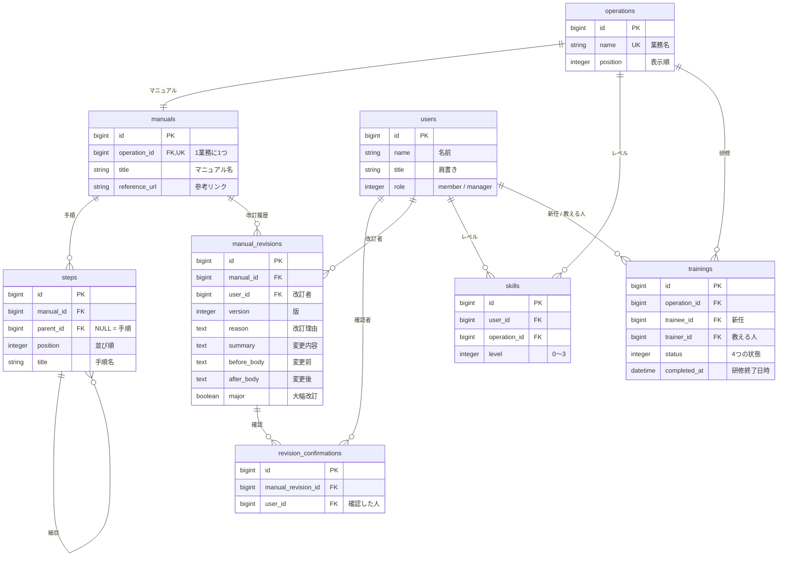

# テーブル設計案（モック v2 から作成）

モック `mock/人事業務ひきつぎアプリ_モックのモック.html` の4画面から必要なデータを洗い出し、
チームで話し合った5テーブル案（users / tasks / skills / manuals / manual_revisions）をもとに見直したものです。

## 1. 画面ごとに必要なデータ

| 画面 | 表示・操作 | 必要なデータ |
|---|---|---|
| 共通ヘッダー | 「操作する人」切り替え、通知、設定（部長用） | ユーザー（名前・肩書き・部長かどうか） |
| スキル一覧 | 担当者 × 業務のレベル表（0〜3）、＋−で変更、属人化チェック | 業務、ユーザー×業務のレベル |
| 業務・研修 | 研修の割り当て → 学習中 → 部長の確認待ち → 研修終了、業務手順の表示・編集 | 研修（新任・教える人・業務・状態）、マニュアルの手順 |
| 業務ツリー | 業務 → 手順 → 細目の3階層、手順数、版（v2・10/18） | 手順（親子関係・並び順）、マニュアルの最新の版 |
| 改訂履歴 | 版・日付・改訂者・改訂理由・変更内容・確認状況・前後比較 | 改訂履歴、変更前後の内容、誰が確認したか |

## 2. 基本の考え方

**スキルは「業務」に、手順と改訂は「マニュアル」に付けます。**

- **業務（operations）** = スキルを測る単位。「田中さんは勤怠締めがレベル3」のように、人 × 業務でレベルを持つ
- **マニュアル（manuals）** = 業務のやり方を書いた文書。手順・版・改訂履歴を持つ

モックの画面でも、スキル一覧は「人 × 業務」、改訂履歴は「マニュアルの版」として分かれているので、画面の構造と一致します。
現時点では1業務につきマニュアルは1つ（1対1）です。将来、複数のマニュアル（例：手順書と FAQ）を持たせたくなった場合は、`has_one` を `has_many` に変えるだけで対応できます。

```
operations（業務） ──1:1── manuals（マニュアル） ──1:n── steps（手順・細目）
      │                          └──1:n── manual_revisions（改訂履歴） ──1:n── revision_confirmations（確認）
      ├──1:n── skills（人 × 業務のレベル）
      └──1:n── trainings（研修）
```

## 3. 元の5テーブル案からの変更点

| 元の案 | 変更 | 理由 |
|---|---|---|
| tasks | **operations（業務）に名前を変える**（推奨） | GitHub の Issue も「タスク」と呼ぶので、チャットで混乱しやすい。`tasks` のままでも技術的には問題ない |
| manuals | そのまま残す。`operation_id` にユニーク制約を付け、参考リンク `reference_url` を追加 | 元の案で改訂ごとに持っていた「リンク」は、マニュアルの参考資料（Google ドキュメントなど）としてここに置く |
| （なし） | **steps（手順・細目）を追加** | モックでは、マニュアルの本文をアプリの中で「手順の一覧」として表示・編集しているため。業務ツリーの3階層は `parent_id` で表す |
| manual_revisions | 「改訂内容」を、**改訂理由・変更内容・変更前後のテキスト**に分ける。版番号を追加 | モックの改訂履歴に、版・理由・変更内容・前後比較があるため。手順を版ごとにコピーすると実装が重いので、改訂時の手順をテキストで保存して並べて表示する |
| skills | そのまま | — |
| （なし） | **trainings（研修）を追加** | 業務・研修画面の中心機能。状態は4つ |
| （なし） | **revision_confirmations（改訂の確認）を追加** | 改訂履歴の「確認状況：2人中2人済み」を表示するため |

## 4. テーブル定義（MVP）

共通：すべてのテーブルに `created_at` / `updated_at` を持つ。

### users（人）
| カラム | 型 | 説明 |
|---|---|---|
| name | string, null: false | 例：田中さん |
| title | string | 肩書き。例：シニア担当（指導役） |
| role | integer (enum), null: false, default: 0 | `member: 0`, `manager: 1`（部長は研修終了を承認できる） |

### operations（業務）
| カラム | 型 | 説明 |
|---|---|---|
| name | string, null: false, unique | 例：勤怠締め |
| position | integer | 表示順 |

### manuals（マニュアル）
| カラム | 型 | 説明 |
|---|---|---|
| operation_id | references, null: false, **unique** | 1業務につき1つ |
| title | string, null: false | 例：勤怠締めマニュアル |
| reference_url | string | 参考資料（Google ドキュメントなど）へのリンク。任意 |

- モデル：`Operation has_one :manual` / `Manual belongs_to :operation`
- 最新の版は「そのマニュアルの改訂履歴のうち `version` が最大のもの」で求める

### steps（手順・細目）
| カラム | 型 | 説明 |
|---|---|---|
| manual_id | references, null: false | |
| parent_id | references (steps), null: true | 空なら手順、入っていれば細目 |
| position | integer, null: false | 同じ親の中での並び順 |
| title | string, null: false | 例：未申請・未承認の勤怠を抽出する |

- 階層は2段まで（手順の下に細目）。細目の下に細目は作れないようにバリデーションを付ける

### skills（力量：ユーザー × 業務）
| カラム | 型 | 説明 |
|---|---|---|
| user_id | references, null: false | |
| operation_id | references, null: false | |
| level | integer, null: false, default: 0 | 0 未経験 / 1 教わりながらできる / 2 一人でできる / 3 人に教えられる |

- `[user_id, operation_id]` にユニーク制約を付ける
- `level` には `inclusion: { in: 0..3 }` のバリデーションを付ける

### trainings（研修）
| カラム | 型 | 説明 |
|---|---|---|
| operation_id | references, null: false | 研修する業務 |
| trainee_id | references (users), null: false | 新任担当 |
| trainer_id | references (users), null: false | 教える人（その業務のレベルが3の人） |
| status | integer (enum), null: false, default: 0 | `not_started: 0`, `in_progress: 1`, `awaiting_approval: 2`, `completed: 3` |
| completed_at | datetime | 研修終了日時 |

- 研修終了時に、新任のその業務のレベルを `max(現在のレベル, 1)` に更新する（モックの「研修終了。鈴木さんの『勤怠締め』は1として扱われます」）

### manual_revisions（改訂履歴）
| カラム | 型 | 説明 |
|---|---|---|
| manual_id | references, null: false | |
| user_id | references, null: false | 改訂者 |
| version | integer, null: false | v1, v2 … |
| reason | text, null: false | 改訂理由 |
| summary | text | 変更内容。例：手順2を追加 |
| before_body | text | 変更前の手順（初版は空） |
| after_body | text, null: false | 変更後の手順 |
| major | boolean, null: false, default: false | 大幅改訂かどうか（元の案から引き継ぎ。使い方は要確認） |

- `[manual_id, version]` にユニーク制約を付ける
- 改訂日は `created_at` を使う

### revision_confirmations（改訂の確認）
| カラム | 型 | 説明 |
|---|---|---|
| manual_revision_id | references, null: false | |
| user_id | references, null: false | 確認した人 |

- `[manual_revision_id, user_id]` にユニーク制約を付ける
- 「2人中2人済み」の分母は、その業務のレベルが1以上の人数とする（要確認）

## 5. ER図



## 6. テーブルを作らないもの（MVP）

| モックの要素 | 方針 |
|---|---|
| ログイン | 作らない。ヘッダーの「操作する人」で選んだユーザーを `session[:user_id]` に保存する |
| 通知 | テーブルを作らず、その場で計算する（例：レベル0なのに研修が未割り当ての人、未確認の改訂） |
| 属人化チェック | その場で計算する（レベル2以上が1人以下の業務） |
| 設定「研修終了の承認」 | MVP では常に承認ありで固定する。余裕があれば設定用のテーブルを追加 |

## 7. 「あとで」候補：手順ごとの習熟度

業務ツリーでは、手順ごとのレベル（例：手順1 で田中3・山本1・鈴木0）や、細目ごとの「経験者 2人」が表示されています。
これを実現するには、次のテーブルが別途必要です。

| テーブル | カラム |
|---|---|
| step_experiences | user_id, step_id, level（または経験済みフラグ） |

ただし、改訂で手順が削除・変更されたときの扱いが難しくなるため、**MVP では業務単位のレベル（skills）だけを表示し、手順ごとの習熟度は「あとで」ラベルにする**ことを提案します。

## 8. PdM（しばさん）に確認したいこと

1. 1つの業務にマニュアルが複数あることはあるか（例：手順書と FAQ を分ける）
2. マニュアルの本文はアプリ内の手順だけか。外部の資料（Google ドキュメントなど）へのリンクも持つか
3. 「大幅改訂」のときに何が起きるようにするか（例：レベル2以上の人にも確認を求める）
4. 業務ツリーの「手順ごとの習熟度・経験者数」は MVP に必要か（上記7）
5. 「確認状況：2人中2人済み」の対象者は誰か（その業務のレベル1以上の人？ 全員？）
6. 研修終了は部長承認が必須か（モックの研修画面では「部長の確認待ち」を飛ばして終了になっている）
7. 手順の編集は誰ができるか（部長だけ？ レベル3の人も？）。編集すると必ず新しい版になるか
8. モックで手順数が合っていない箇所の正解（業務ツリーでは勤怠締めが「7手順」、業務・研修画面では5手順）
